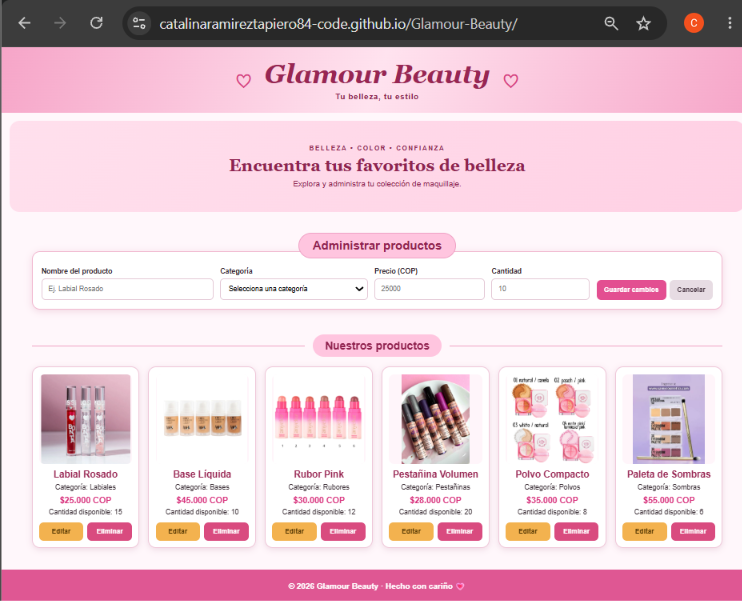

# 💗 Glamour Beauty

Aplicación web académica para administrar productos de maquillaje mediante operaciones CRUD.

## Funcionalidades
- **Create (Crear):** agregar productos.
- **Read (Leer):** visualizar productos.
- **Update (Actualizar):** editar productos.
- **Delete (Eliminar):** eliminar productos.
- Almacenamiento de datos en el navegador mediante `localStorage`.
- Imágenes locales para las categorías de maquillaje.

## Tecnologías
- HTML5
- CSS3
- JavaScript
- LocalStorage

## Cómo ejecutar
1. Descarga o descomprime la carpeta del proyecto.
2. Abre `Glamour-Beauty` en Visual Studio Code.
3. Abre `index.html` en un navegador (o usa Live Server).
4. Agrega, edita o elimina productos desde el formulario.

## Estructura
```text
Glamour-Beauty/
├── index.html
├── styles.css
├── script.js
├── README.md
└── imagenes/
    ├── labiales.jpg
    ├── bases.jpg
    ├── polvos.jpg
    ├── pestaninas.jpg
    ├── rubores.jpg
    ├── sombras.jpg
    └── correctores.jpg
```
##Prompts utilizados con inteligencia artificial

Prompt 1. Creación del proyecto

Se solicitó a ChatGPT ayuda para crear una aplicación web CRUD de productos de maquillaje llamada Glamour Beauty, utilizando HTML, CSS y JavaScript.

Objetivo: establecer la estructura inicial y las funcionalidades del proyecto.

Prompt 2. Generación y corrección del código

Se solicitó generar el código completo y corregido de los archivos HTML, CSS y JavaScript.

Objetivo: implementar las operaciones para crear, visualizar, actualizar y eliminar productos.

Prompt 3. Incorporación de imágenes

Se preguntó cómo agregar imágenes de productos de maquillaje al código HTML y JavaScript.

Objetivo: mejorar la presentación visual de los productos.

Prompt 4. Corrección de errores

Se solicitó ayuda para solucionar el problema por el cual los productos no aparecían en la página.

Objetivo: corregir el funcionamiento de la aplicación y visualizar correctamente los productos.

##evidencia 



